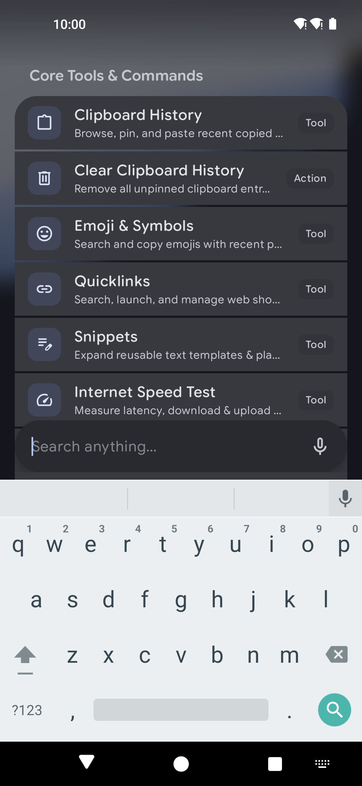
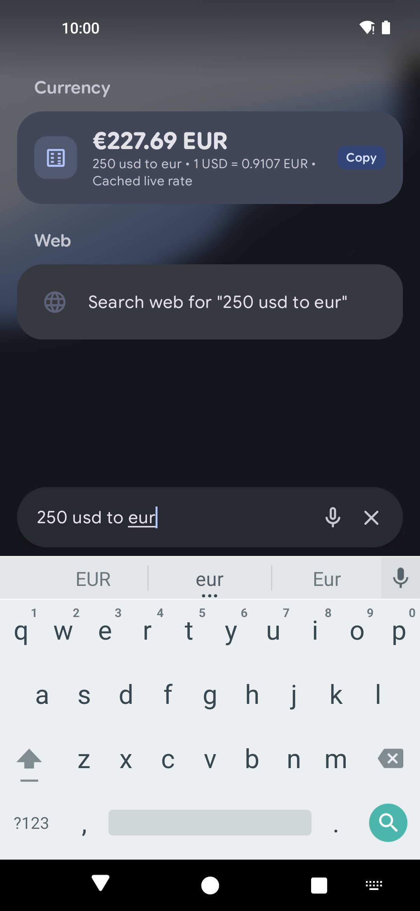
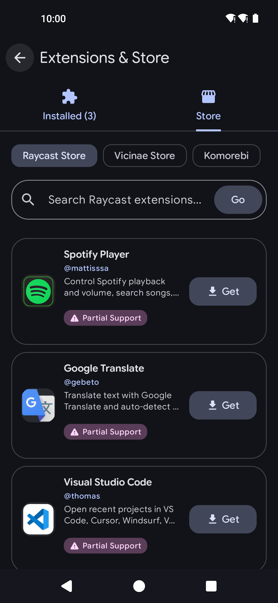
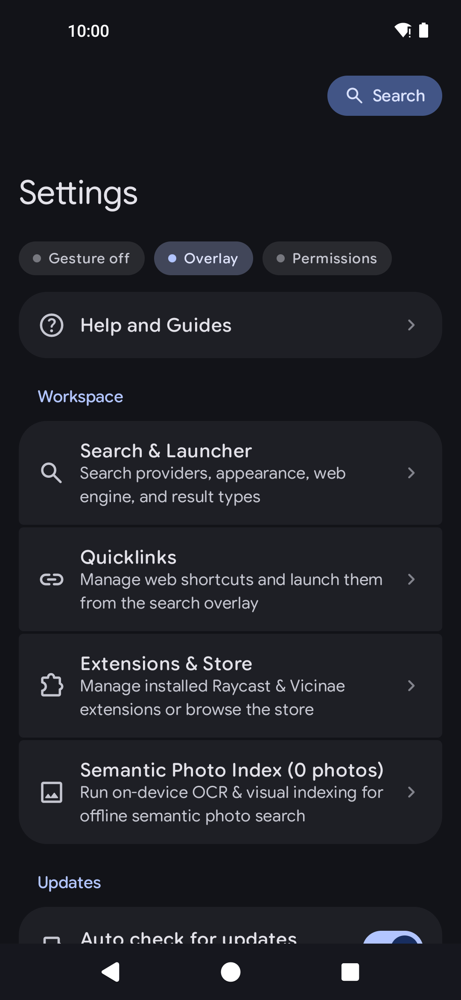
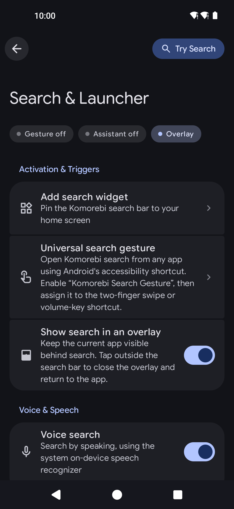

<div align="center">

# Komorebi

**A fast, extensible command palette, universal launcher, and Raycast / Vicinae extension runtime for Android.**

[](https://github.com/aislingheart/komorebi/releases/latest)
[](https://github.com/aislingheart/komorebi/releases)
[-3DDC84?style=for-the-badge&logo=android&logoColor=white)](https://github.com/aislingheart/komorebi/releases/latest)
[](LICENSE)

[Screenshots](#screenshots) • [Features](#features) • [Installation](#installation) • [Permissions](#permissions--privileged-mode) • [Building](#building-from-source) • [Credits](#credits--acknowledgments)

</div>

---

## Screenshots

<div align="center">
<table>
  <tr>
    <td align="center">
      <br />
      <sub><b>Command Palette</b></sub>
    </td>
    <td align="center">
      <br />
      <sub><b>Calculator & Currency</b></sub>
    </td>
    <td align="center">
      <br />
      <sub><b>Extensions & Store</b></sub>
    </td>
    <td align="center">
      <br />
      <sub><b>Settings</b></sub>
    </td>
    <td align="center">
      <br />
      <sub><b>Search & Triggers</b></sub>
    </td>
  </tr>
</table>
</div>

---

## Features

### Universal Command Palette & Search
- **Instant Local & Web Search:** Search installed apps, app shortcuts, contacts, local files, system settings, custom web search engines, and supported third-party app search providers from a single overlay.
- **On-Device Semantic Photo Search:** Index your photo library completely offline using on-device ML Kit OCR and visual indexing so you can search photos by text or content directly from the search bar.
- **Context-Aware Ranking:** Learns from recent launches and usage patterns to surface your most relevant apps, tools, and commands first.

### Raycast & Vicinae Extensions Runtime + Store
- **Native Store Browser:** Browse and install extensions directly from the **Raycast Store** and **Vicinae Store**, complete with automatic Android compatibility analysis (`Full` / `Partial Support` badges).
- **JavaScript / TypeScript Extension Engine:** Runs `@raycast/api` and `@vicinae/api` extensions natively in Jetpack Compose (`List`, `Grid`, `Detail`, `Form`, `ActionPanel`, and toast/HUD feedback) inline or full-screen.
- **OAuth & Deep Linking:** Built-in OAuth flow support (`komorebi://oauth`, `raycast://oauth`) for authenticated extensions.

### Built-in Productivity Tools & Live Calculator
- **Live Calculator & Converter:** Evaluate math expressions, units, dates, timezones, and currency conversions (with cached live exchange rates and offline fallback) right as you type.
- **Clipboard History:** Browse, pin, paste, and clear recent clipboard entries.
- **Quicklinks & Snippets:** Create reusable web shortcuts and dynamic text templates with placeholders.
- **Emoji & Symbols Picker:** Quickly search and copy emojis and kaomoji with recent picks.
- **Utilities & Device Actions:** Built-in **Internet Speed Test** (native latency, download & upload Mbps), **Nearby Bus Times**, **QR Code Generator**, **UUID v4 / Strong Password / ISO-8601 Timestamp** generators, **Flashlight**, **Clock / Alarms / Timers**, **Lock Screen**, and **Screenshot** actions.

### On-Device Assistant & Health Connect
- **Natural-Language & Deterministic Tools:** Trigger system toggles, audio/display controls, media playback, alarms & timers, notification digests, calendar entries, tasks & reminders, routines, web search/fetch, screen text/context extraction, and persistent assistant memory.
- **Health Connect Integration:** Query your on-device Health Connect data (steps, sleep, heart rate, weight, and exercise sessions) privately without sending health records to external servers.

### Triggers, Gestures & Material 3 Expressive UI
- **Open From Anywhere:** Trigger Komorebi as your **Default Assistant** (`ACTION_ASSIST`), via the **Universal Search Gesture** (Accessibility shortcut) with an **AGSL Gesture Ripple Reveal** animation, or from the **Home-Screen Search Widget**.
- **Pixel-Inspired Material 3 Expressive Design:** Features a clean Pixel Settings layout, **Pitch-Black AMOLED** theme, optional window blur, custom app icons, per-app language selection, and customizable haptic feedback.
- **Built-in Updater & Backup:** Automatic GitHub Releases update checks and full JSON configuration export/import.

---

## Installation

1. Download the latest APK from [**GitHub Releases**](https://github.com/aislingheart/komorebi/releases/latest):
   - **`app-arm64-v8a-release.apk`** — recommended for most modern Android phones (smaller download).
   - **`app-release.apk`** — universal APK supporting `arm64-v8a`, `armeabi-v7a`, and `x86_64`.
2. Install the APK on any device running **Android 8.0 (API 26) or newer**.
3. *(Android 13+)* If you enable the **Universal Search Gesture** (Accessibility) or **Notification Listener** and Android blocks the toggle, open **Settings → Apps → Komorebi → ⋮ (top-right) → Allow restricted settings**, then re-enable the permission.

---

## Permissions & Privileged Mode

Komorebi requests permissions **only** for the features you choose to enable:

| Capability | Permission / Service | Purpose |
| --- | --- | --- |
| Universal Search Gesture & Screen Actions | Accessibility Service | Open the command palette from any app, grab screen text, lock screen, or take screenshots |
| Notification Digest & Media Controls | Notification Listener | Summarize notifications and control active media sessions |
| Default Assistant | Voice Interaction / Assist | Launch Komorebi from the system assistant gesture or power/home hold |
| Health Queries | Health Connect | Read local steps, sleep, heart rate, weight, and workout data on-device |
| System Toggles & Advanced Actions *(Optional)* | **Shizuku** or **Root** | Run privileged system commands without needing a PC |

---

## Building from Source

### Prerequisites
- **JDK 21**
- **Android SDK** (configured via `ANDROID_HOME` or `local.properties`)

### Build & Test

```bash
git clone https://github.com/aislingheart/komorebi.git
cd komorebi

# Build a debug APK
./gradlew :app:assembleDebug

# Run unit tests
./gradlew :app:testDebugUnitTest
```

Signed release builds use a local `~/.android/komorebi-signing.properties` file (`storeFile`, `storePassword`, `keyAlias`, `keyPassword`) if present; otherwise `./gradlew :app:assembleRelease` produces unsigned release APKs.

---

## Credits & Acknowledgments

Komorebi is developed by [Aisling](https://aislingheart.github.io/Portfolio/) and builds upon the work of these open-source projects and ecosystems:

- [**Essentials**](https://github.com/sameerasw/essentials) by Sameera Sandakelum — foundational Android codebase and Material 3 architecture.
- [**Vicinae**](https://github.com/vicinaehq/vicinae) — launcher design and `@vicinae/api` extension ecosystem inspiration.
- [**Raycast Extensions**](https://github.com/raycast/extensions) — `@raycast/api` compatibility and community extension catalog.
- [**emojis.json**](https://gist.github.com/oliveratgithub/0bf11a9aff0d6da7b46f1490f86a71eb) & [**generate-kaomoji**](https://github.com/kurochenko/generate-kaomoji) — emoji and kaomoji datasets.

---

## License

Komorebi is licensed under the [**MIT License**](LICENSE).
